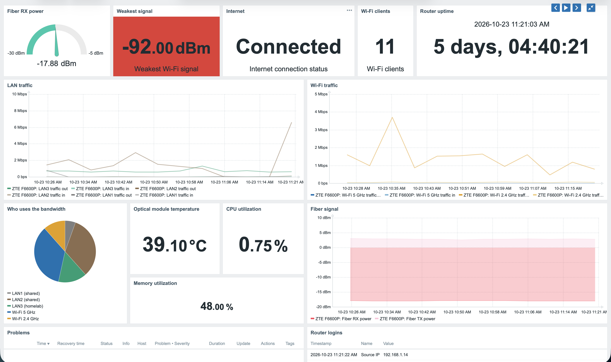

# Zabbix monitoring for the ZTE F6600P (no SNMP)

A Zabbix Script item that monitors a ZTE ZXHN F6600P fiber router, the GPON box Maroc Telecom supplies, which has no SNMP. The script logs in to the router's web admin page the same way the browser does, reads the status pages, logs out, and returns everything as one JSON document. Dependent items pick each metric out of it.

The full story, from DevTools to the dashboard: [Monitoring a ZTE F6600P with Zabbix, without SNMP](https://darni.org/blog/monitoring-zte-f6600p-zabbix).

## Tested on

| | |
|---|---|
| Router | ZTE ZXHN F6600P |
| Firmware | V9.0.10P8N4 (Maroc Telecom) |
| Zabbix | 7.0.31 LTS |

Other firmware versions may use different endpoints or field names. If it doesn't work on yours, open an issue with the firmware version.

## What it collects

- **Fiber:** RX/TX power (dBm), optical module temperature, voltage, bias current, loss of signal, GPON registration state
- **Internet:** connection status, connection uptime
- **Router:** CPU (average of 4 cores), memory, uptime
- **LAN ports:** traffic in/out, errors in/out, link status, speed
- **Wi-Fi:** traffic per band, number of clients, weakest client signal, number of LAN devices

The script only reads. Apart from the login and logout, every request is a GET, so it never changes a router setting.

## Setup

### 1. Host

Create a host (for example `ZTE F6600P`). It needs no agent and no interface. Add three macros:

| Macro | Value | Type |
|---|---|---|
| `{$ZTE.URL}` | `http://192.168.1.1` | Text |
| `{$ZTE.USER}` | your admin user | Text |
| `{$ZTE.PASSWORD}` | your admin password | **Secret text** |

### 2. Master item

| Field | Value |
|---|---|
| Name | `ZTE: status (raw)` |
| Type | Script |
| Key | `zte.status` |
| Type of information | Text |
| Parameters | `url` = `{$ZTE.URL}`, `user` = `{$ZTE.USER}`, `password` = `{$ZTE.PASSWORD}` |
| Script | contents of [`zte_status.js`](zte_status.js) |
| Timeout | `20s` |
| Update interval | `5m` |
| History | `1d` (the raw JSON is only useful for debugging) |

Click **Test** to check it returns JSON before saving.

### 3. Dependent items

Every item below is **Type:** Dependent item, **Master item:** `ZTE: status (raw)`, with a JSONPath preprocessing step.

| Name | Key | JSONPath | Extra preprocessing | Units |
|---|---|---|---|---|
| Fiber RX power | `zte.rx_power` | `$.rx_power` | | dBm |
| Fiber TX power | `zte.tx_power` | `$.tx_power` | | dBm |
| Optical module temperature | `zte.temp` | `$.temp` | | °C |
| Optical module voltage | `zte.voltage` | `$.voltage_mv` | | mV |
| Optical module bias current | `zte.bias` | `$.bias_ma` | | mA |
| Fiber loss of signal | `zte.los` | `$.los` | | |
| GPON registration state | `zte.reg_status` | `$.reg_status` | | |
| Internet connection status | `zte.internet_status` | `$.internet_status` | | |
| Internet connection uptime | `zte.internet_uptime` | `$.internet_uptime` | | uptime |
| CPU utilization | `zte.cpu` | `$.cpu` | | % |
| Memory utilization | `zte.mem` | `$.mem` | | % |
| Router uptime | `zte.uptime` | `$.uptime` | | uptime |
| LAN*N* traffic in | `zte.lanN.in` | `$.lan.lanN.in_bytes` | Change per second, Custom multiplier `8` | bps |
| LAN*N* traffic out | `zte.lanN.out` | `$.lan.lanN.out_bytes` | Change per second, Custom multiplier `8` | bps |
| LAN*N* errors in | `zte.lanN.in_errors` | `$.lan.lanN.in_errors` | | |
| LAN*N* errors out | `zte.lanN.out_errors` | `$.lan.lanN.out_errors` | | |
| LAN*N* link status | `zte.lanN.status` | `$.lan.lanN.status` | | |
| Wi-Fi 2.4 GHz traffic in | `zte.wifi24.in` | `$.wifi.ssid1.rx_bytes` | Change per second, Custom multiplier `8` | bps |
| Wi-Fi 2.4 GHz traffic out | `zte.wifi24.out` | `$.wifi.ssid1.tx_bytes` | Change per second, Custom multiplier `8` | bps |
| Wi-Fi 5 GHz traffic in | `zte.wifi5.in` | `$.wifi.ssid5.rx_bytes` | Change per second, Custom multiplier `8` | bps |
| Wi-Fi 5 GHz traffic out | `zte.wifi5.out` | `$.wifi.ssid5.tx_bytes` | Change per second, Custom multiplier `8` | bps |
| Wi-Fi clients | `zte.wifi_clients` | `$.wifi_clients` | | |
| Weakest Wi-Fi signal | `zte.wifi_rssi_min` | `$.wifi_rssi_min` | | dBm |
| LAN devices | `zte.lan_devices` | `$.lan_devices` | | |

Replace `N` with the port number (1 to 4). Use **Numeric (float)** for the power, temperature, CPU and traffic items, and **Character** for the internet status.

Notes:

- **Direction** is from the router's side. `in` is what the router receives (the device uploading), `out` is what it sends (the device downloading).
- **Weakest Wi-Fi signal** is missing from the JSON when no client is connected. On its JSONPath step, set **Custom on fail** to **Discard value**, or the item turns *Not supported* overnight.
- **Value meanings** found by comparing with the web UI (not documented by ZTE): LAN `status` `0` = up, `1` = down. `speed` `3` = 1 Gbps. `reg_status` `5` = O5, operational. `los` `1` = loss of signal.
- After adding items, use **Execute now** on the master item to fill them without waiting five minutes.

### 4. Triggers

Replace `ZTE F6600P` with your host's name.

| Name | Severity | Expression |
|---|---|---|
| Fiber signal weak | Warning | `last(/ZTE F6600P/zte.rx_power)<-25` |
| Fiber loss of signal | High | `last(/ZTE F6600P/zte.los)=1` |
| Internet connection down | High | `last(/ZTE F6600P/zte.internet_status)<>"Connected"` |
| Router data not received for 15m | Average | `nodata(/ZTE F6600P/zte.rx_power,15m)=1` |
| Router has been restarted | Information | `last(/ZTE F6600P/zte.uptime)<600` |
| Router memory high | Warning | `min(/ZTE F6600P/zte.mem,15m)>90` |
| Optical module hot | Warning | `last(/ZTE F6600P/zte.temp)>70` |

The `nodata` trigger matters most: the host has no interface, so it's the only thing that notices when the script stops working (router unreachable, password changed, firmware changed, or someone holding the admin session).

## Limits

- **One admin session at a time.** While someone is logged in to the web UI, the script's login is refused and monitoring pauses until they log out.
- **Firmware updates** can change the login, the endpoints or the field names.
- **No WAN byte counter** on these pages. Total internet traffic can be approximated by adding the LAN and Wi-Fi *out* rates.
- **Fixed items for now.** A template with low-level discovery for ports and Wi-Fi clients is planned.

## License

[MIT](LICENSE)